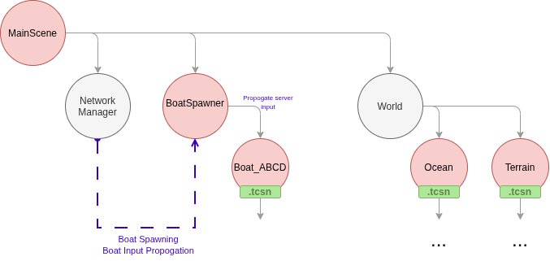
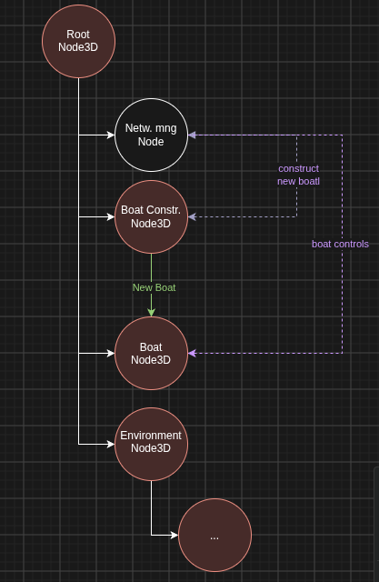

# The Archipelago, and more... 
Welcome to the simulation part of the project!  

**Structure**
- Keep all scripts in `scripts/` folder.
- `assets/` will keep aaaall of the project's assets, which includes `shaders` and any other .tres files that get created.
- `packedscenes/` contains "prefabs". You can see that boat components are in there for instance. These scenes are meant to be used inside of other scenes, such as constructing a boat, etc..  
- `playscenes/` contains any scene that is meant to be played (differing from `packedscenes/`)
- Avoid making edits directly to `main_scene.tscn`. This is to avoid difficult merge conflicts. This scene should only be edited once features are stable enough to be orchestrated into it. Until then, make copies of the main_scene if you want to use features of it.
- Develop features in dedicated scenes and scripts. Keep main_scene.tscn for integration; coordinate changes to it with the integration owner. (-gepete)

## Node ownership

- **`main_scene.tscn` is the composition root.** It contains one `NetworkManager`, the `Boats` container, and the world and presentation nodes. It connects feature scenes without owning their internal behavior.
- **`NetworkManager` owns network transport.** It opens and maintains the WebSocket, decodes server messages, and emits signals for boat data and control events. It does not create, find, or modify boat nodes.
- **`Boats` owns boat spawning.** Its `boat_spawner.gd` listens to the sibling `NetworkManager` signals, creates and updates boats, assigns their positions, and routes controls to the matching boat.
- **Each `Boat` owns its identity and behavior.** A boat is configured with its data and handles boat-specific controls. Its ID label is part of the Boat scene.
- **Each `Boat` contains one `MeshConstructor`.** The constructor builds or refreshes that boat's visuals from data. It does not connect to the network or fetch data.
- **World features own their internals.** Keep ocean, terrain, camera, and other feature logic in their own scripts or packed scenes as they grow. `main_scene.tscn` should compose those features.
- **Keep dependencies flowing through these interfaces:** `NetworkManager` signals → `boat_spawner.gd` → `Boat.configure()` or `Boat.apply_control()` → `MeshConstructor.build_from_data()`.

## Godot workflow 
Godot is a Node-based Game engine where everything is a tree of nodes! Nodes can be anything: From audio players, mesh instances, hitboxes, particle systems, to simply holding a script. There exist three main nodes: Node3D, Node2D, and Node. the latter of the three is a parent to the rest. 

### Propagate down, Signal Up
A saying in Godot goes something like this: 
> "Propagate down, Signal Up." 

The first part is simple & intuitive: if a node needs to be updated that is further down the tree, update it as usual. The latter part talks about how nested nodes should send updates further up the tree: You should always use signals, which are Godot's very intuitive and easy to use Observer pattern implementation (need a source)

### Exports are awesome!
@export is a very powerful keyword which lets you fiddle around with a script via Godot UI. Although it may feel convenient to use a bunch of magic numbers while working on a script, taking the time to write some huge & pretty @export blocks helps everyone a lot. [more info from the docs here!](https://docs.godotengine.org/en/stable/tutorials/scripting/gdscript/gdscript_exports.html) 

### Naming Conventions
|     Type     |   Convention  |          Example          |
|:------------:|:-------------:|:-------------------------:|
| File names   | snake_case    | yaml_parser.gd            |
| Class names  | PascalCase    | class_name YAMLParser     |
| Node names   | PascalCase    | Camera3D, Player          |
| Functions    | snake_case    | func load_level():        |
| Variables    | snake_case    | var particle_effect       |
| Signals      | snake_case    | signal door_opened        |
| Constants    | CONSTANT_CASE | const MAX_SPEED = 200     |
| Enum names   | PascalCase    | enum Element              |
| Enum members | CONSTANT_CASE | {EARTH, WATER, AIR, FIRE} |

## Simulation Logic
A network manager will establish connection to server backend. It will send a signal to notify the boat constructor to spawn in a boat inside of a generic `Boats` Node3D with correct settings. 

A spawned boat will have an assigned ID. When a client interacts with a boat via phone controls, the network manager will send a signal to Boats, which will then propagate the controls to the related singular boat. 

If each boat ends up having unique properties based on its build or some setting, we can give it its own script and propogate the call down into the boat.

Why keep boat constructor and client interaction seperate? umm SOLID or something. it makes for more manageable code.

## Boat reconstruction
todo

## Terrain Generation
todo

### Shaders
todo 
#### Boat shaders
todo
#### Ocean shaders
todo
#### Fog shaders
todo
